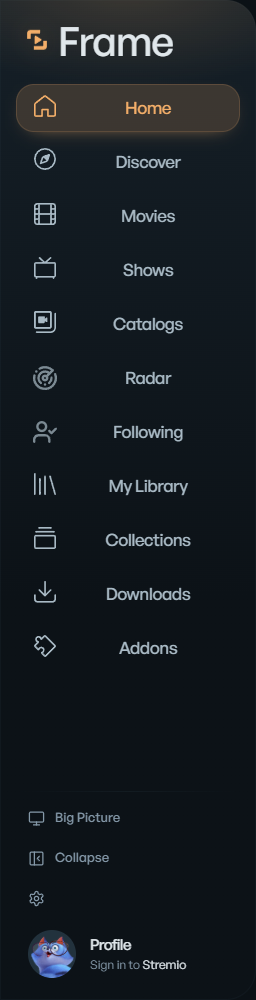
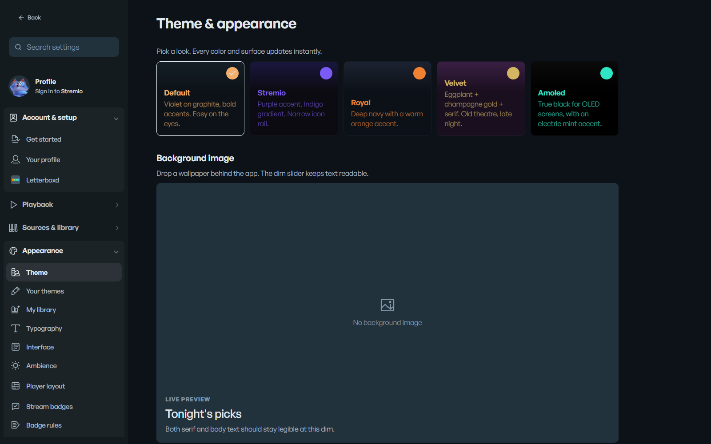
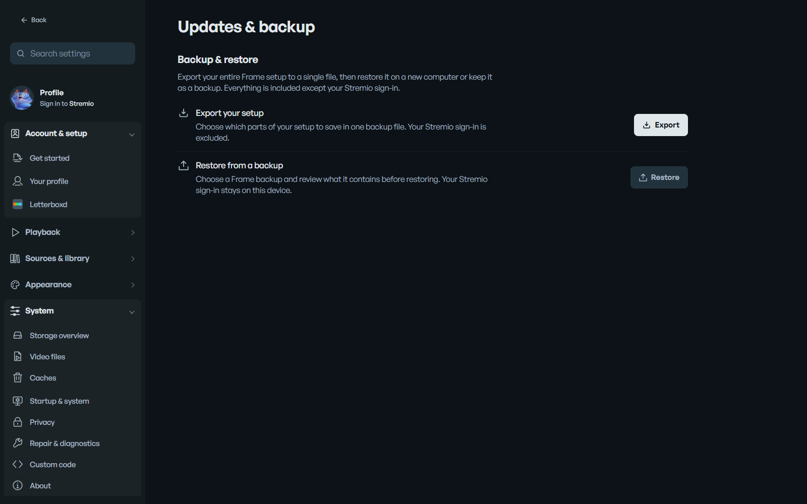
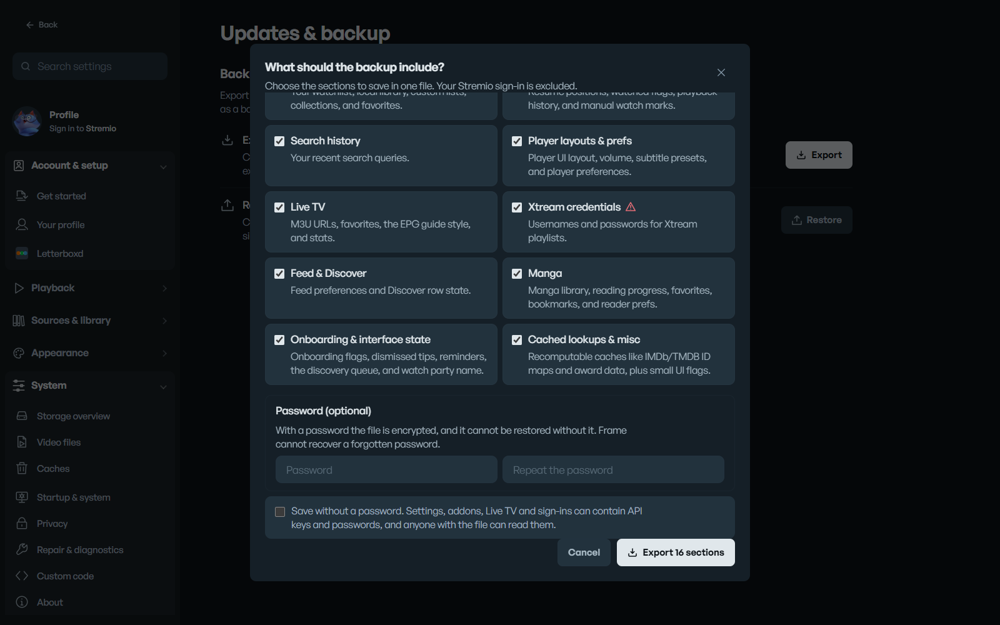

# Frame

A personal desktop media app for movies and TV, built with Tauri 2, React, TypeScript, Rust and libmpv.

Version 0.2.0.

Frame began as a fork of [Harbor](https://github.com/crazyrabbit0/harbor), a Stremio client, and keeps its MIT license and notice. See [LICENSE](LICENSE) and `src-tauri/THIRD-PARTY-NOTICES.txt`.

## Screenshots

| Sidebar                                                                                                  | Theme selection                                                                                  |
| -------------------------------------------------------------------------------------------------------- | ------------------------------------------------------------------------------------------------ |
|  |  |

| Backup & restore                                                                      | Choosing what a backup includes                                                                            |
| ------------------------------------------------------------------------------------- | ---------------------------------------------------------------------------------------------------------- |
|  |  |

## What it does

- **Browse:** Home, Discover, Movies, TV Shows and My Library, with global search, advanced filters and right-click menus.
- **Radar:** For You, Trending / Popular, Digital Releases, Discover and Upcoming / New Releases, using your computer's local time zone.
- **Following:** the actors, directors and crew you follow, their latest and upcoming work, and people you might like. Radar and Following share the same list.
- **Watch:** a native mpv player with embedded playback, online subtitles, resume, skip intro and outro, picture-in-picture and the existing player extras.
- **Sources:** Stremio and its add-ons, extensions and local files, with metadata and artwork from TMDB.
- **Profile:** your Stremio account is your profile. Frame's local settings stay separate from it, and Frame works without signing in.
- **Track:** Letterboxd is the only tracker.
- **Themes:** Default, Stremio, Royal, Velvet and Amoled. Themes import and export as `.framestyle` files.

Backups save as `frame-backup-YYYY-MM-DD.framex`, optionally encrypted with a password (AES-256-GCM). Both `.framex` and older `.harbx` backups can be imported. Before a restore, the desktop app saves a copy of your current setup to its data folder (`backups/`, newest five kept), and a restore that cannot finish is rolled back. Custom JavaScript and HTML in a backup are only restored if you tick that option. Backups hold settings and app data only, never your video files.

The phone remote and Frame in a browser are off until you turn them on (**Settings > Sources & library > P2P & servers > Server**, or Big Picture's phone setup). A phone or another Frame has to pair before it can control this one: it asks for a code, Frame shows the code on its own screen, and you type it on the device. The same section lists paired devices and forgets them, and forgetting a device disconnects it at once.

## Install

Requirements: Windows 10 or 11 (x64). Frame officially builds and releases Windows x64 only. macOS and Linux code may remain in the repository but is not tested or distributed.

Download the Windows x64 installer from [Releases](https://github.com/A67med/frame/releases). The Windows installer includes mpv and its runtime files. Windows also needs WebView2, which the installer sets up if it's missing.

Frame stores its data under the identifier `io.github.abdallahkattriah-sketch.frame`. On first launch it copies data from a v0.1.0 install (`app.harbor`) and leaves the original folder in place.

## TMDB key

Radar, Following and most artwork read from TMDB. Add your own key in **Settings > Sources & library > Library & metadata**.

## Build

```sh
pnpm install
pnpm run setup          # fetches ffmpeg, yt-dlp, libmpv, mpv, fonts
pnpm tauri build --bundles nsis
```

The installer is written to `src-tauri/target/release/bundle/nsis/`. On Windows you also need the MSVC toolchain, CMake and the Rust toolchain.

To regenerate the logo, icons and installer art, run `node scripts/generate-brand.mjs`, then `pnpm tauri icon src-tauri/icons/source.png`.

## Updates

Frame checks GitHub Releases for a newer version and downloads it in the background (unless you dismissed that version or your connection is in Data Saver mode). It installs and restarts only when you choose, and it refuses an update whose signature does not match the key built into the app. There is one stable channel.

## Releases

Merging reviewed changes into `main` triggers the Windows-only Release workflow. The workflow prepares a consistent version, builds a signed Windows x64 NSIS installer, checks required bundled runtimes, generates a Windows-only `latest.json`, and publishes the GitHub Release automatically only after the build succeeds. macOS/Linux/Flatpak do not block Windows publication; Flatpak is manual-only. In-app updates require the `TAURI_SIGNING_PRIVATE_KEY` Actions secret matching `plugins.updater.pubkey` in `src-tauri/tauri.conf.json`. Builds with the previous updater public key may need a one-time manual installation.

## Development

```sh
pnpm install
pnpm dev                 # browser build on http://127.0.0.1:1420
pnpm tauri dev           # desktop app
pnpm run typecheck
pnpm test
```

`scripts/test-installer-hooks.ps1` checks the Windows installer hook against decoy processes.

## License

MIT. See [LICENSE](LICENSE).
